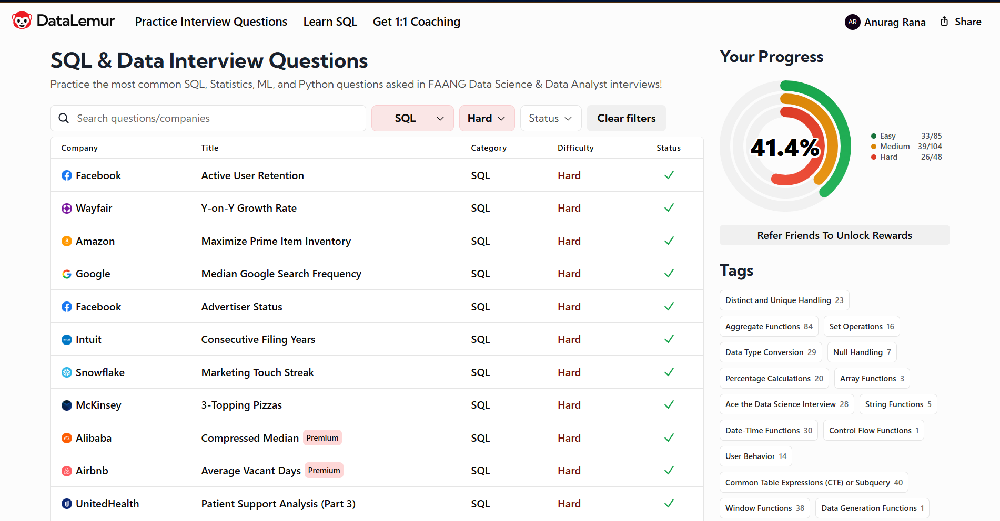

# Hi, I'm Anurag Rana 👋

Graduate Computer Science student at the University of Texas at Dallas with 4+ years of professional software development experience. Passionate about backend engineering, data engineering, distributed systems, and building scalable applications.

## About Me

- Pursuing an MS in Computer Science at UT Dallas.
- Experienced in backend development, REST APIs, and database-driven applications.
- Exploring data engineering, analytics, and distributed data processing.
- Interested in solving complex engineering and analytical problems.

## Technical Skills

**Programming Languages:** C++, JavaScript, SQL

**Backend Development:** Node.js, Express.js, REST APIs

**Frontend Development:** React.js, HTML, CSS

**Databases:** PostgreSQL, MongoDB

**Data Engineering & Analytics:** Databricks, SQL, Data Transformation

**Tools:** Git, GitHub, Postman

## SQL & Analytical Problem Solving

Solved **98 SQL interview problems** on DataLemur using PostgreSQL, covering real-world analytical challenges from companies such as Google, Amazon, Meta, Microsoft, and Snowflake.

| Difficulty | Problems Solved |
|------------|----------------:|
| 🟢 Easy | 33 |
| 🟠 Medium | 39 |
| 🔴 Hard | 26 |
| **Total** | **98** |

### Concepts Covered

- Common Table Expressions (CTEs)
- Window and ranking functions
- Complex joins and subqueries
- Conditional aggregation
- Date and time manipulation
- Customer retention and churn analysis
- Year-over-year growth analysis
- Running totals and rolling averages
- Consecutive event analysis
- Analytical problem-solving

### DataLemur Progress

## Featured Projects

### Databricks Analytics Project

Data analytics project focused on revenue analysis, customer behavior, monthly trends, and interactive dashboards using Databricks and SQL.

### Mini Google File System

A distributed file system built using C++ and TCP socket programming, implementing data replication, fault tolerance, and high availability.

### Photo Sharing Application

A full-stack web application implementing REST APIs, session-based authentication, database integration, and server-state management.

## Currently Exploring

- Medallion Architecture
- Data Engineering Pipelines
- Advanced SQL
- Distributed Systems
- Data Structures and Algorithms

## Connect With Me

- GitHub: [anuragrana1997](https://github.com/anuragrana1997)

---

*Always learning, building, and solving problems.*
